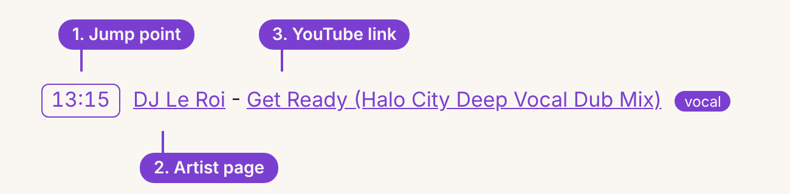
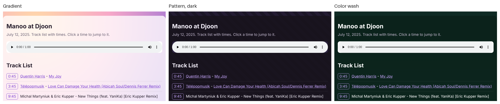
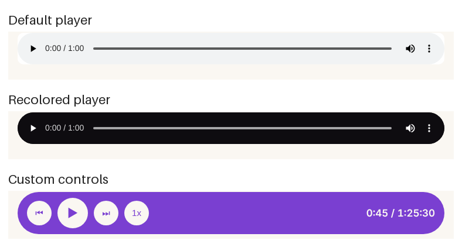

# djmix-tracklist

Build a timestamped track list from a long DJ mix or live set.

The tool cuts short samples from the recording, identifies each one with Shazam,
and merges the results into a list you can paste into a web page or a post.
It was built by The Fertile Soil to add track lists to our community DJ recordings.

## Requirements

- Python 3.10 or newer
- ffmpeg and ffprobe
- pip install -r requirements.txt

## Use

    python scripts/scan.py mix.mp3 60 0  > hits_a.jsonl
    python scripts/scan.py mix.mp3 60 30 > hits_b.jsonl
    python scripts/merge.py hits_a.jsonl hits_b.jsonl

The first number is the step in seconds. The second is the starting offset.
Running two passes offset by half the step catches short blends.
Use a smaller step (20 to 30 seconds) to zoom in on a section.

## Check the results

- Shazam can return a wrong match from a single sample. Tracks heard once are
  marked unconfirmed. Listen before you publish them.
- Blends, edits, acapellas and remixes are often missed. Fill gaps by ear.
- Mixes with live vocals over a track can confuse matching.

## The skill

SKILL.md describes the workflow in the Agent Skills format, so an AI
coding assistant can run it for you.

## Example

examples/manoo-djoon holds a finished track list for a two hour mix, with a player and
clickable times. Open its index.html in a browser. The audio file is not included.

## What each track holds

Every track in the list has three parts:

1. A jump point. Click the time and the player jumps to that spot in the mix.
2. The artist page. A link to the artist website or channel.
3. A YouTube link to the track.

## Make it your own

The example page is plain HTML and CSS, so you can change the look.

**Background.** Set a color, a gradient or an image on the body:

    body { background: linear-gradient(180deg, #0f2a24, #1f5a45); color: #fff; }
    main { background: rgba(10, 30, 24, 0.72); border-radius: 16px; }
    /* or an image: body { background: url(cover.jpg) center / cover fixed; } */

**Controls.** Restyle the built in player, or hide it and draw your own buttons that call play(), pause() and set currentTime on the audio element:

    audio { filter: invert(1) hue-rotate(250deg); border-radius: 40px; }

## Share and improve

This project is MIT licensed. Fork it, change it, and share your version.
Ideas: other recognition services, vocal-only detection, a web interface.
